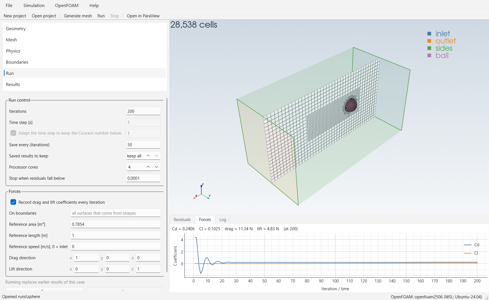
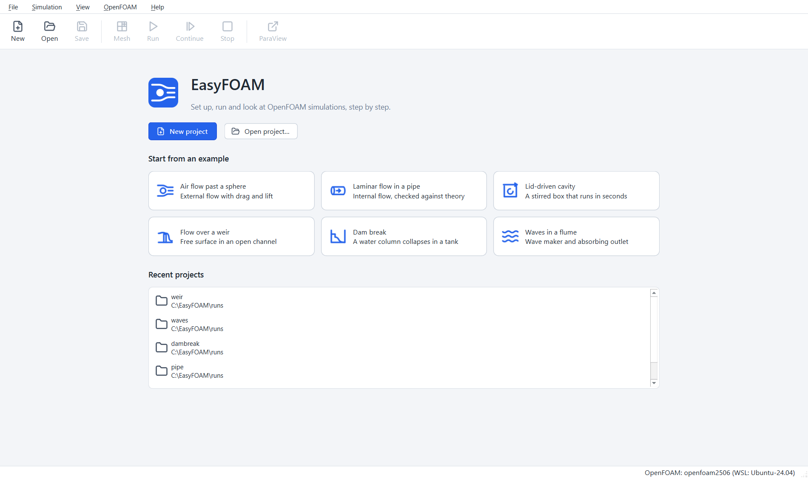
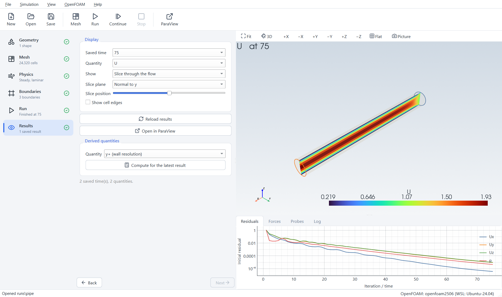
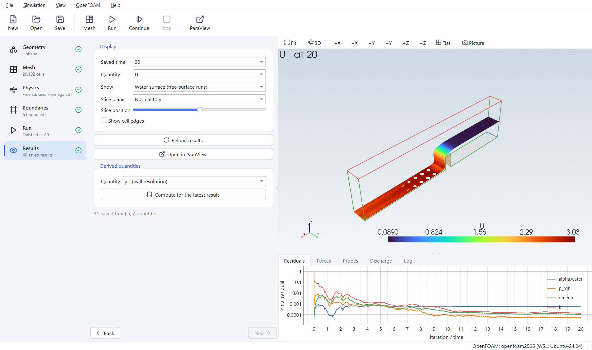

# EasyFOAM

An open-source desktop front-end for [OpenFOAM](https://www.openfoam.com).
Geometry, meshing, case set-up, running and results in one window, driving
**your own, unmodified OpenFOAM** and leaving a normal case folder on disk.



Status: **v0.5, alpha.** The whole loop works for incompressible flow around
bodies, inside pipes and ducts, and with a free water surface (weirs, spillways,
dam breaks); see
[what works](#what-works-today) and the [roadmap](docs/roadmap.md).

## Why another GUI

Good free tools already exist: [BARAM](https://github.com/nextfoam/baram)
(standalone, ships its own solvers) and [CfdOF](https://github.com/jaheyns/CfdOF)
(inside FreeCAD). EasyFOAM aims at a different spot:

- it runs the stock OpenFOAM you already have (through WSL on Windows, natively on Linux);
- the case stays plain OpenFOAM, with the exact scripts that were run kept in `.easyfoam/`;
- every operation is also a command, so cases can be scripted;
- no limits on cells or processor cores.

## Made to be easy

- A start page with examples and your recent projects; a new project only needs a name.
- Six steps down the left, each with a one-line summary and a tick, a warning or a to-do mark.
- A checklist before every run says in plain words what is still missing or wrong.
- Back / Next buttons walk through the steps; every input explains itself in a tooltip.
- Selecting a shape or a boundary lights it up in the 3D view; view buttons for fit, axis views and pictures.
- Stop saves the current state first; Continue carries on from where a run ended.



## What works today

| | |
|---|---|
| Geometry | STEP / IGES / BREP import (optional `gmsh` package), length unit chosen on import; STL import (ASCII and binary), with each named solid of an STL usable as a wall or an opening; box, sphere, cylinder primitives; shapes as solid surfaces or refinement regions |
| Mesh | Base mesh box with named faces; automatic sizing (wind tunnel, or snug box for internal flow); snappyHexMesh with surface refinement, refinement regions and by distance, feature edges and boundary layers; fluid outside or inside a shape; checkMesh report |
| Free surface | Water and air with a free surface (interFoam): gravity, surface tension, water placed as boxes or filled to a level, time step that follows the water surface; a sharper-interface variant (interIsoFoam); regular waves with a wave maker and an absorbing outlet; discharge and water-depth monitors |
| Physics | Incompressible flow, steady (simpleFoam) and transient (pimpleFoam); laminar, k-epsilon, realizable k-epsilon, k-omega SST, Spalart-Allmaras; potential-flow start; small fluid list |
| Boundaries | Velocity inlet, inlet by flow rate (follows the water level in free-surface flow), pressure outlet, free outflow, outlet at a tailwater level, wave maker, wave-absorbing outlet, open atmosphere, wall, moving wall, slip, symmetry / empty; sensible defaults from patch names and types |
| Run | Serial or parallel (automatic decomposition and reconstruction); live residual plot; convergence target; drag and lift coefficients with a live plot and forces in newtons; probes; frontal-area estimate; graceful stop and continue; the final state is always saved; log |
| Results | Built-in 3D view (mesh, slices, surface colouring, the water surface coloured by speed); y+, wall shear stress, vorticity and Q computed on demand; one click to ParaView |

Everything else a commercial front-end offers (heat transfer, free surface,
rotating machinery, STEP import, …) is listed with its status in
[docs/feature-map.md](docs/feature-map.md).

## Requirements

- Windows 10/11 with WSL 2, or Linux.
- OpenFOAM from openfoam.com (tested with v2506).
- Python 3.11 or newer.
- Optional: [ParaView](https://www.paraview.org) for detailed post-processing.

OpenFOAM inside WSL (Ubuntu), if you do not have it yet:

```bash
wsl --install -d Ubuntu-24.04
```

then, inside Ubuntu:

```bash
curl -s https://dl.openfoam.com/add-debian-repo.sh | sudo bash
sudo apt-get install openfoam2506-default
```

## Install

With [uv](https://docs.astral.sh/uv/):

```bash
uv venv --python 3.13 .venv
uv pip install --python .venv/Scripts/python.exe -e ".[gui,dev]"
```

(on Linux the interpreter is `.venv/bin/python`), or with plain pip:
`pip install -e ".[gui]"`. Add the `cad` extra (`.[gui,cad]`) to import STEP and IGES files.

## Use

Desktop application:

```bash
.venv/Scripts/python.exe -m easyfoam.gui.app
```

Then *File > New from example* (air flow past a sphere, laminar flow in a pipe,
the lid-driven cavity, flow over a weir, a dam break, or waves in a flume), press **Generate mesh** (F5) and **Run** (F6). The steps on the left go in order: Geometry, Mesh,
Physics, Boundaries, Run, Results.

Command line, same operations:

```bash
easyfoam runtimes                       # which OpenFOAM installations were found
easyfoam new mycase --example sphere    # create a project
easyfoam import-stl mycase part.stl --fit
easyfoam mesh mycase
easyfoam run mycase --np 8
easyfoam info mycase
```

## Checked against theory

The pipe example (Re = 50) is part of the test suite: the centre-line speed must
come out at twice the mean speed (Hagen-Poiseuille). On the example's coarse
24,000-cell mesh it gives 1.93 against 2.0, and a pressure gradient of 3.15
against the exact 3.2 m²/s² per metre.



### Flow over a weir

The weir example sends 0.05 m³/s over a 0.5 m wide, 0.25 m thick, 0.51 m high weir. After 20 s the flow is
steady: the discharge monitor shows 0.0488 m³/s leaving and the gauge in the reservoir reads a depth of
0.669 m, which is 0.159 m above the crest (a second estimate from the water volume gives 0.169 m; one
cell is 0.03 m high). The ideal broad-crested weir formula gives 0.151 m; a real square-edged weir has
losses, which puts the simulated head a little above it, as expected. The example mesh is coarse
(20,000 cells, about five cells over the head), so treat this as a plausibility check, not a calibration.

The wave-flume example asks for 0.04 m waves with a 1.5 s period and measures 0.038 m and 0.037 m at its
two gauges, with the mean level unchanged and no water piling up at the absorbing end.



The dam-break example conserves its water to within 1 % while the surge crosses the tank.

## How a case is laid out

```
mycase/
  easyfoam.json        the project (everything you chose)
  mycase.foam          marker file for ParaView
  system/ constant/ 0/ ordinary OpenFOAM dictionaries, regenerated from the project
  log.blockMesh …      the output of each tool
  .easyfoam/mesh.sh    the exact script that was run; rerun it by hand if you like
```

## Develop

```bash
.venv/Scripts/python.exe -m pytest                    # everything, incl. real OpenFOAM runs
.venv/Scripts/python.exe -m pytest -m "not openfoam"  # fast tests only
.venv/Scripts/python.exe -m ruff check easyfoam tests
```

Design notes are in [docs/design.md](docs/design.md).

## Clean-room statement

EasyFOAM is an independent work. Its feature list was informed by the public
websites and documentation of existing tools; no proprietary program was
reverse engineered, decompiled or copied. See
[docs/feature-map.md](docs/feature-map.md) for the rules contributors follow.

## Licence and trademarks

GPL-3.0-or-later, see [LICENSE](LICENSE).

Most icons are from [Lucide](https://lucide.dev) (ISC licence, text in
`easyfoam/gui/icons/LICENSE-lucide.txt`); the mesh, example and logo icons are EasyFOAM's own.

This offering is not approved or endorsed by OpenCFD Limited, producer and
distributor of the OpenFOAM software via www.openfoam.com, and owner of the
OPENFOAM® and OpenCFD® trade marks. It is not affiliated with SIMFLOW
Technologies or any other GUI vendor.
