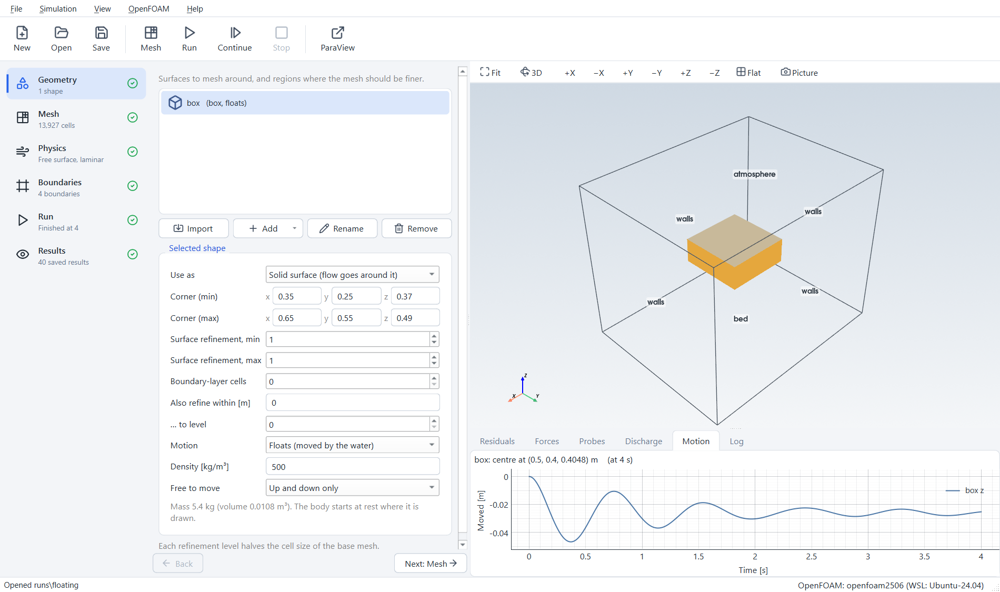
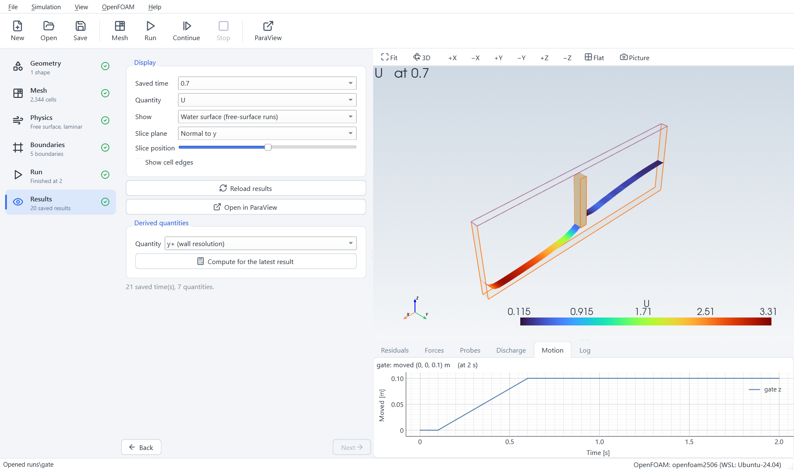

# EasyFOAM

An open-source desktop front-end for [OpenFOAM](https://www.openfoam.com).
Geometry, meshing, case set-up, running and results in one window, driving
**your own, unmodified OpenFOAM** and leaving a normal case folder on disk.


Status: **v0.8, alpha.** The whole loop works for incompressible flow around
bodies, inside pipes and ducts, and with a free water surface (weirs, spillways,
dam breaks), including gates that move and bodies that float; see
[what works](#what-works-today) and the [roadmap](docs/roadmap.md).

## Why another GUI

Good free tools already exist: [BARAM](https://github.com/nextfoam/baram)
(standalone, ships its own solvers) and [CfdOF](https://github.com/jaheyns/CfdOF)
(inside FreeCAD). EasyFOAM aims at a different spot:

- it runs the stock OpenFOAM you already have (through WSL on Windows, natively on Linux);
- the case stays plain OpenFOAM, with the exact scripts that were run kept in `.easyfoam/`;
- every operation is also a command, so cases can be scripted;
- no limits on cells or processor cores.

## Made to be easy

- A start page with examples and your recent projects; a new project only needs a name.
- Six steps down the left, each with a one-line summary and a tick, a warning or a to-do mark.
- A checklist before every run says in plain words what is still missing or wrong.
- Back / Next buttons walk through the steps; every input explains itself in a tooltip.
- Selecting a shape or a boundary lights it up in the 3D view; view buttons for fit, axis views and pictures.
- Stop saves the current state first; Continue carries on from where a run ended.


## What works today

| | |
|---|---|
| Geometry | Draw shapes in the program: box, sphere, cylinder, cone, wedge (ramp), and an outline sketched with the mouse and extruded (the cross-section of a weir, spillway or duct); move and resize them with handles in the 3D view. Or import: STEP / IGES / BREP (optional `gmsh` package) and STL (ASCII and binary), with the length unit chosen on import and each named solid of an STL usable as a wall or an opening. Drawn and imported shapes mix freely, as solid surfaces or refinement regions |
| Mesh | Base mesh box with named faces; automatic sizing (wind tunnel, or snug box for internal flow); snappyHexMesh with surface refinement, refinement regions and by distance, feature edges and boundary layers; fluid outside or inside a shape; checkMesh report |
| Free surface | Water and air with a free surface (interFoam): gravity, surface tension, water placed as boxes or filled to a level, time step that follows the water surface; a sharper-interface variant (interIsoFoam); waves (Stokes 1st, 2nd and 5th order, cnoidal, solitary) with a wave maker and an absorbing outlet; contact angle; mesh refinement that follows the water surface; cavitation index; discharge and water-depth monitors |
| Moving shapes | A solid shape can move to a new position over a set time (a gate that opens), swing back and forth, or float: a floating body is moved by the water and its own weight (6DoF), with its mass and inertia worked out from its shape and density; live plot of position and tilt |
| Physics | Incompressible flow, steady (simpleFoam) and transient (pimpleFoam); laminar, k-epsilon (standard, realizable, RNG), k-omega (standard, SST), Spalart-Allmaras, k-kl-omega transition; wall functions or resolved boundary layer; non-Newtonian fluids; a passive tracer; velocity limiter; potential-flow start; small fluid list |
| Boundaries | Velocity inlet, inlet by flow rate (follows the water level in free-surface flow), pressure outlet, free outflow, outlet at a tailwater level, wave maker, wave-absorbing outlet, open atmosphere, wall, moving wall, slip, symmetry / empty; sensible defaults from patch names and types |
| Run | Serial or parallel (automatic decomposition and reconstruction); live residual plot; convergence target; drag and lift coefficients with a live plot and forces in newtons; probes; frontal-area estimate; graceful stop and continue; the final state is always saved; log |
| Results | Built-in 3D view (mesh, slices, surface colouring, the water surface coloured by speed); y+, wall shear stress, vorticity and Q computed on demand; one click to ParaView |

Everything else a commercial front-end offers (heat transfer, free surface,
rotating machinery, STEP import, …) is listed with its status in
[docs/feature-map.md](docs/feature-map.md).

## Tutorials

Eleven step-by-step tutorials, from installing to a spillway built from your own STL file, are in [docs/](docs/index.html) as a
small website: open `docs/index.html` in a browser. Every click is numbered in a picture of the
real program and every value is given.

| | |
|---|---|
| Install and first look | Lid-driven cavity (built from an empty project) |
| Laminar flow in a pipe | Air flow past a sphere |
| Dam break | Flow over a weir |
| Waves in a flume | Lifting sluice gate |
| Floating box | Spillway from your own geometry (STL) |
| Draw your own weir (sketch pad and mouse handles) | |

The site is made from the tutorial descriptions in `website/tutorials/`. The same description
operates the real application to take the pictures and produces the page text, so the two cannot
drift apart:

```bash
python -m website shots     # run every tutorial in the real program and take the pictures (needs OpenFOAM)
python -m website build     # write the pages into docs/
python -m website check     # are the pages up to date and all pictures there?
```

The site is plain files with relative links, so it can be hosted anywhere; on GitHub, choose
*Settings > Pages > Deploy from a branch > main, /docs*.

## Requirements

- Windows 10/11 with WSL 2, or Linux.
- OpenFOAM from openfoam.com (tested with v2506).
- Python 3.11 or newer.
- Optional: [ParaView](https://www.paraview.org) for detailed post-processing.

OpenFOAM inside WSL (Ubuntu), if you do not have it yet:

```bash
wsl --install -d Ubuntu-24.04
```

then, inside Ubuntu:

```bash
curl -s https://dl.openfoam.com/add-debian-repo.sh | sudo bash
sudo apt-get install openfoam2506-default
```

## Install

With [uv](https://docs.astral.sh/uv/):

```bash
uv venv --python 3.13 .venv
uv pip install --python .venv/Scripts/python.exe -e ".[gui,dev]"
```

(on Linux the interpreter is `.venv/bin/python`), or with plain pip:
`pip install -e ".[gui]"`. Add the `cad` extra (`.[gui,cad]`) to import STEP and IGES files.

## Use

Desktop application:

```bash
.venv/Scripts/python.exe -m easyfoam.gui.app
```

Then *File > New from example* (air flow past a sphere, laminar flow in a pipe,
the lid-driven cavity, flow over a weir, a dam break, waves in a flume, a lifting
sluice gate, or a floating box), press **Generate mesh** (F5) and **Run** (F6). The steps on the left go in order: Geometry, Mesh,
Physics, Boundaries, Run, Results.

Command line, same operations:

```bash
easyfoam runtimes                       # which OpenFOAM installations were found
easyfoam new mycase --example sphere    # create a project
easyfoam import-stl mycase part.stl --fit
easyfoam mesh mycase
easyfoam run mycase --np 8
easyfoam info mycase
```

## Checked against theory

The pipe example (Re = 50) is part of the test suite: the centre-line speed must
come out at twice the mean speed (Hagen-Poiseuille). On the example's coarse
24,000-cell mesh it gives 1.93 against 2.0, and a pressure gradient of 3.15
against the exact 3.2 m²/s² per metre.


### Flow over a weir

The weir example sends 0.05 m³/s over a 0.5 m wide, 0.25 m thick, 0.51 m high weir. After 20 s the flow is
steady: the discharge monitor shows 0.0488 m³/s leaving and the gauge in the reservoir reads a depth of
0.669 m, which is 0.159 m above the crest (a second estimate from the water volume gives 0.169 m; one
cell is 0.03 m high). The ideal broad-crested weir formula gives 0.151 m; a real square-edged weir has
losses, which puts the simulated head a little above it, as expected. The example mesh is coarse
(20,000 cells, about five cells over the head), so treat this as a plausibility check, not a calibration.

The wave-flume example asks for 0.04 m waves with a 1.5 s period and measures 0.038 m and 0.037 m at its
two gauges, with the mean level unchanged and no water piling up at the absorbing end.


The dam-break example conserves its water to within 1 % while the surge crosses the tank.

### A floating box and a lifting gate

The floating-box example drops a 0.3 x 0.3 x 0.12 m box of half the density of water into a tank,
3 cm above where it belongs. By Archimedes it must float 6 cm deep, with its centre at the water
surface, which the box itself raises from 0.400 m to 0.4034 m. The run has the box bob with a period of
about 0.8 s, each swing smaller than the last, and settle at 0.404 m. With all six directions free the
same box stays upright (it tilts by less than 2°) and floats at the same depth.



The sluice-gate example lifts a gate by 0.1 m in half a second. The bottom edge of the gate in the saved
meshes is at 0.100 m before the lift, about 0.160 m three fifths of the way through and 0.200 m
afterwards, while the bed stays exactly where it was. It runs the same on one processor and on two.



What to know about moving shapes:

- The mesh stretches to follow a shape; no cells are added or removed. Keep a movement well below the
  gap to the nearest wall. A gate can open further or close part of the way, but not shut completely,
  and a floating body cannot roll over.
- Water placed as a box fills whole cells, so the starting water level lands on the nearest layer of
  cells. For a floating body, choose the cell height so that the water level falls between two layers
  (the example uses 4 cm cells and a level of 0.40 m).
- A floating body starts at rest where it is drawn. Bodies that float and shapes with a set motion
  cannot be mixed in one run yet.

## How a case is laid out

```
mycase/
  easyfoam.json        the project (everything you chose)
  mycase.foam          marker file for ParaView
  system/ constant/ 0/ ordinary OpenFOAM dictionaries, regenerated from the project
  log.blockMesh …      the output of each tool
  .easyfoam/mesh.sh    the exact script that was run; rerun it by hand if you like
```

## Develop

```bash
.venv/Scripts/python.exe -m pytest                    # everything, incl. real OpenFOAM runs
.venv/Scripts/python.exe -m pytest -m "not openfoam"  # fast tests only
.venv/Scripts/python.exe -m ruff check easyfoam tests
```

Design notes are in [docs/design.md](docs/design.md).
The tutorials website is described under [Tutorials](#tutorials).

## Clean-room statement

EasyFOAM is an independent work. Its feature list was informed by the public
websites and documentation of existing tools; no proprietary program was
reverse engineered, decompiled or copied. See
[docs/feature-map.md](docs/feature-map.md) for the rules contributors follow.

## Licence and trademarks

GPL-3.0-or-later, see [LICENSE](LICENSE).

Most icons are from [Lucide](https://lucide.dev) (ISC licence, text in
`easyfoam/gui/icons/LICENSE-lucide.txt`); the mesh, example and logo icons are EasyFOAM's own.

This offering is not approved or endorsed by OpenCFD Limited, producer and
distributor of the OpenFOAM software via www.openfoam.com, and owner of the
OPENFOAM® and OpenCFD® trade marks. It is not affiliated with SIMFLOW
Technologies or any other GUI vendor.
