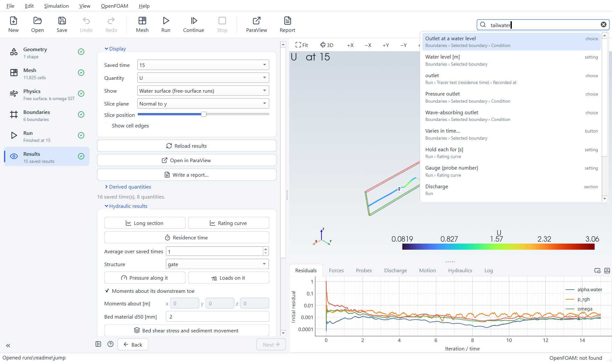
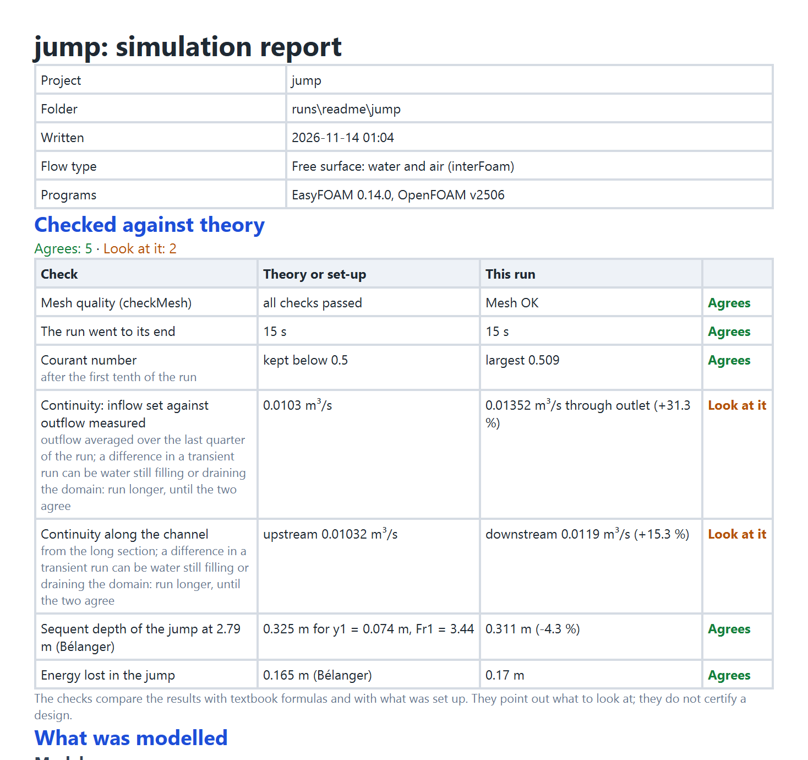
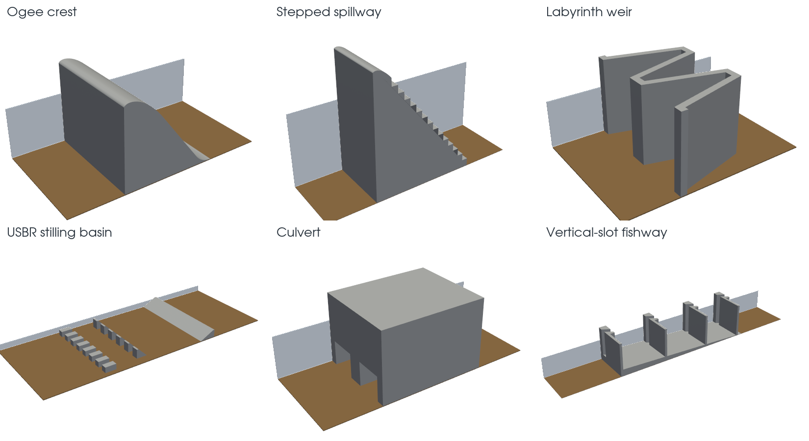

<p align="center"></p>

# EasyFOAM

An open-source desktop front-end for [OpenFOAM](https://www.openfoam.com).
Geometry, meshing, case set-up, running and results in one window, driving
**your own, unmodified OpenFOAM** and leaving a normal case folder on disk.


Status: **v0.14, alpha.** The whole loop works for incompressible flow around
bodies, inside pipes and ducts, and with a free water surface (weirs, spillways,
dam breaks, channels, river reaches, hydraulic structures), including gates that
move and bodies that float; see [what works](#what-works-today) and the
[roadmap](docs/roadmap.md).

## Why another GUI

Good free tools already exist: [BARAM](https://github.com/nextfoam/baram)
(standalone, ships its own solvers) and [CfdOF](https://github.com/jaheyns/CfdOF)
(inside FreeCAD). EasyFOAM aims at a different spot:

- it runs the stock OpenFOAM you already have (through WSL on Windows, natively on Linux);
- the case stays plain OpenFOAM, with the exact scripts that were run kept in `.easyfoam/`;
- every operation is also a command, so cases can be scripted;
- no limits on cells or processor cores.

## Made to be easy

- A start page with examples and your recent projects; a new project only needs a name.
- Six steps down the left, each with a one-line summary and a tick, a warning or a to-do mark.
- A checklist before every run says in plain words what is still missing or wrong.
- Back / Next buttons walk through the steps; every input explains itself in a tooltip, and the **?** of
  each step opens the tutorial that shows it, at that step.
- **Ctrl+K** finds any setting or command by name, or by another word for it ("tailwater", "gauge",
  "Strickler", "CFL"), and goes there.
- Long forms are in sections that fold to one line and say what they hold; the ones most projects do
  not need start folded, and every section stays the way it was left.
- Panels resize and fold away; the plots and the log can move to a window of their own, for a second
  screen. A light and a dark theme, and a text size of your choice.
- Number fields take units ("50 mm", "3 l/s", "10 cfs") and arithmetic, and say why a value is refused;
  every change can be undone.
- Drop a project folder, STL / STEP files or a survey on the window to open them; keep a set-up as a
  template and start new projects from it.
- Selecting a shape or a boundary lights it up in the 3D view; view buttons for fit, axis views and
  pictures. In the 3D view, read the value under the cursor, place gauges and probes with a click,
  measure distances and draw the line the long section follows.
- Stop saves the current state first; Continue carries on from where a run ended; a long run says how
  long it still needs and announces when it ends.
- **One click writes a report** for a design note: the set-up, the mesh, the run, plots and pictures,
  and the results checked against theory (continuity, Bélanger, critical depth, the WES crest, USBR
  basins, Manning), as a web page or a PDF.






## What works today

| | |
|---|---|
| Geometry | Draw shapes in the program: box, sphere, cylinder, cone, wedge (ramp), and an outline sketched with the mouse and extruded (the cross-section of a weir, spillway or duct); move and resize them with handles in the 3D view. Or import: STEP / IGES / BREP (optional `gmsh` package) and STL (ASCII and binary), with the length unit chosen on import and each named solid of an STL usable as a wall or an opening. Drawn and imported shapes mix freely, as solid surfaces or refinement regions |
| Mesh | Base mesh box with named faces; automatic sizing (wind tunnel, or snug box for internal flow); snappyHexMesh with surface refinement, refinement regions and by distance, feature edges and boundary layers; fluid outside or inside a shape; checkMesh report |
| Free surface | Water and air with a free surface (interFoam): gravity, surface tension, water placed as boxes or filled to a level, time step that follows the water surface; a sharper-interface variant (interIsoFoam); waves (Stokes 1st, 2nd and 5th order, cnoidal, solitary) with a wave maker and an absorbing outlet; contact angle; mesh refinement that follows the water surface; cavitation index; discharge and water-depth monitors |
| Hydraulic results | Long section along a straight or curved centreline: water level, bed, energy line, Froude number, specific energy, discharge; hydraulic jumps compared with Bélanger and control sections with critical depth; pressure along a structure and the force and overturning moment on it; bed shear stress and sediment mobility; a 1D Manning profile to compare; rating-curve sweeps; tables saved as CSV |
| Channels and terrain | Build a channel from its cross-section (rectangular, trapezoidal, compound with floodplains, circular culvert), bed slope and a centreline of straight pieces and bends, with a mesh fitted to it; or bring in the ground of a river reach from XYZ points, an ESRI ASCII grid, a GeoTIFF or a LandXML surface |
| Hydraulic structures | Made from their design values and drawn from the side and from above as they are typed: an ogee crest shaped by the WES standard for its design head, with its design discharge; a stepped spillway, with its flow regime (nappe, transition or skimming); a labyrinth weir; USBR stilling basins Types II, III and IV sized from the entering depth and Froude number; a box or pipe culvert through an embankment, its barrels on or buried in the bed; a vertical-slot fishway |
| Contact tanks | Several tracers with inlet concentrations, first-order decay (chlorine) and the age of the water; a tracer test (step or pulse) giving T10, mean residence time, baffling factor and Morrill index, and the residual of a decaying substance at the outlet |
| Moving shapes | A solid shape can move to a new position over a set time (a gate that opens), swing back and forth, or float: a floating body is moved by the water and its own weight (6DoF), with its mass and inertia worked out from its shape and density; live plot of position and tilt |
| Physics | Incompressible flow, steady (simpleFoam) and transient (pimpleFoam); laminar, k-epsilon (standard, realizable, RNG), k-omega (standard, SST), Spalart-Allmaras, k-kl-omega transition; wall functions or resolved boundary layer; non-Newtonian fluids; tracers; velocity limiter; potential-flow start; small fluid list |
| Boundaries | Velocity inlet, inlet by flow rate (follows the water level in free-surface flow), inflow hydrographs, pressure outlet, free outflow, outlet at a tailwater level (fixed or changing in time), wall roughness as Manning's n or a sand-grain height, wave maker, wave-absorbing outlet, open atmosphere, wall, moving wall, slip, symmetry / empty; sensible defaults from patch names and types |
| Run | Serial or parallel (automatic decomposition and reconstruction); live residual plot; convergence target; drag and lift coefficients with a live plot and forces in newtons; probes; frontal-area estimate; graceful stop and continue; the final state is always saved; log |
| Results | Built-in 3D view (mesh, slices, surface colouring, the water surface coloured by speed) with values under the cursor; y+, wall shear stress, vorticity and Q computed on demand; one click to ParaView |
| Reports | A web page or PDF of the project: inputs, geometry and structure design values, mesh and checkMesh, boundaries, the run (time reached, Courant number, residuals), monitors, the 3D view and every plot, and checks against theory with a verdict for each (continuity, jumps against Bélanger, control sections against critical depth, the WES crest coefficient, USBR basin depth and length, uniform flow by Manning) |

Everything else a commercial front-end offers (heat transfer, free surface,
rotating machinery, STEP import, …) is listed with its status in
[docs/feature-map.md](docs/feature-map.md).

## Tutorials

Nineteen step-by-step tutorials, from installing to a river reach read from a survey, are in [docs/](docs/index.html) as a
small website: open `docs/index.html` in a browser. Every click is numbered in a picture of the
real program and every value is given.

| | |
|---|---|
| Install and first look | Lid-driven cavity (built from an empty project) |
| Laminar flow in a pipe | Air flow past a sphere |
| Dam break | Flow over a weir |
| Waves in a flume | Lifting sluice gate |
| Floating box | Spillway from your own geometry (STL) |
| Draw your own weir (sketch pad and mouse handles) | Hydraulic jump: long section and loads |
| Ogee spillway crest from its design head | Stilling basin from the flow entering it (USBR Type III) |
| Rating curve of a weir | Contact tank: water age and a tracer test |
| Build a channel with a bend | A flood through a bend (hydrograph, rising tailwater, bed shear) |
| A river reach from a survey | |

The site is made from the tutorial descriptions in `website/tutorials/`. The same description
operates the real application to take the pictures and produces the page text, so the two cannot
drift apart:

```bash
python -m website shots     # run every tutorial in the real program and take the pictures (needs OpenFOAM)
python -m website build     # write the pages into docs/
python -m website check     # are the pages up to date and all pictures there?
```

The site is plain files with relative links, so it can be hosted anywhere; on GitHub, choose
*Settings > Pages > Deploy from a branch > main, /docs*.

## Requirements

- Windows 10/11 with WSL 2, or Linux.
- OpenFOAM from openfoam.com (tested with v2506).
- Python 3.11 or newer.
- Optional: [ParaView](https://www.paraview.org) for detailed post-processing.

OpenFOAM inside WSL (Ubuntu), if you do not have it yet:

```bash
wsl --install -d Ubuntu-24.04
```

then, inside Ubuntu:

```bash
curl -s https://dl.openfoam.com/add-debian-repo.sh | sudo bash
sudo apt-get install openfoam2506-default
```

## Install

With [uv](https://docs.astral.sh/uv/):

```bash
uv venv --python 3.13 .venv
uv pip install --python .venv/Scripts/python.exe -e ".[gui,dev]"
```

(on Linux the interpreter is `.venv/bin/python`), or with plain pip:
`pip install -e ".[gui]"`. Add the `cad` extra (`.[gui,cad]`) to import STEP and IGES files.

## Use

Desktop application:

```bash
.venv/Scripts/python.exe -m easyfoam.gui.app
```

Then *File > New from example* (air flow past a sphere, laminar flow in a pipe,
the lid-driven cavity, flow over a weir, a dam break, waves in a flume, a lifting
sluice gate, a floating box, a hydraulic jump, a chlorine contact tank, an ogee spillway crest or a
stilling basin), press **Generate mesh** (F5) and **Run** (F6). The steps on the left go in order: Geometry, Mesh,
Physics, Boundaries, Run, Results.

Command line, same operations:

```bash
easyfoam runtimes                       # which OpenFOAM installations were found
easyfoam new mycase --example sphere    # create a project
easyfoam import-stl mycase part.stl --fit
easyfoam mesh mycase
easyfoam run mycase --np 8
easyfoam info mycase
easyfoam long-section mycase --average 5 --csv long.csv   # water level, energy line, Froude number...
easyfoam pressure mycase gate                              # pressure along a structure
easyfoam loads mycase gate                                 # force and overturning moment on it
easyfoam channel river --piece straight:20 --piece bend:15:60 --slope 0.001   # build a channel
easyfoam terrain reach dem.tif --angle 30 --cell 1 --water 99.3   # flow over a surveyed valley
easyfoam structure mycase ogee --station 2 --set design_head=0.12   # a spillway crest from its design head
easyfoam structure mycase basin --set basin_type=4 --set froude=3.5   # a USBR stilling basin
easyfoam report mycase -o mycase.pdf                       # a report, checked against theory (or .html)
```

## Checked against theory

The pipe example (Re = 50) is part of the test suite: the centre-line speed must
come out at twice the mean speed (Hagen-Poiseuille). On the example's coarse
24,000-cell mesh it gives 1.93 against 2.0, and a pressure gradient of 3.15
against the exact 3.2 m²/s² per metre.


### Flow over a weir

The weir example sends 0.05 m³/s over a 0.5 m wide, 0.25 m thick, 0.51 m high weir. After 20 s the flow is
steady: the discharge monitor shows 0.0488 m³/s leaving and the gauge in the reservoir reads a depth of
0.669 m, which is 0.159 m above the crest (a second estimate from the water volume gives 0.169 m; one
cell is 0.03 m high). The ideal broad-crested weir formula gives 0.151 m; a real square-edged weir has
losses, which puts the simulated head a little above it, as expected. The example mesh is coarse
(20,000 cells, about five cells over the head), so treat this as a plausibility check, not a calibration.

The wave-flume example asks for 0.04 m waves with a 1.5 s period and measures 0.038 m and 0.037 m at its
two gauges, with the mean level unchanged and no water piling up at the absorbing end.


The dam-break example conserves its water to within 1 % while the surge crosses the tank.

### A floating box and a lifting gate

The floating-box example drops a 0.3 x 0.3 x 0.12 m box of half the density of water into a tank,
3 cm above where it belongs. By Archimedes it must float 6 cm deep, with its centre at the water
surface, which the box itself raises from 0.400 m to 0.4034 m. The run has the box bob with a period of
about 0.8 s, each swing smaller than the last, and settle at 0.404 m. With all six directions free the
same box stays upright (it tilts by less than 2°) and floats at the same depth.


The sluice-gate example lifts a gate by 0.1 m in half a second. The bottom edge of the gate in the saved
meshes is at 0.100 m before the lift, about 0.160 m three fifths of the way through and 0.200 m
afterwards, while the bed stays exactly where it was. It runs the same on one processor and on two.


What to know about moving shapes:

- The mesh stretches to follow a shape; no cells are added or removed. Keep a movement well below the
  gap to the nearest wall. A gate can open further or close part of the way, but not shut completely,
  and a floating body cannot roll over.
- Water placed as a box fills whole cells, so the starting water level lands on the nearest layer of
  cells. For a floating body, choose the cell height so that the water level falls between two layers
  (the example uses 4 cm cells and a level of 0.40 m).
- A floating body starts at rest where it is drawn. Bodies that float and shapes with a set motion
  cannot be mixed in one run yet.

### Hydraulics, contact tanks and channels

These are part of the test suite too, with real OpenFOAM runs:

- A hydraulic jump below a sluice gate: averaged over the last saved times, the sequent depth is within
  2 % of Bélanger and the energy loss within 3 %; the force on the gate is within 5 % of the momentum
  balance. On the weir, the depth on the crest is critical depth within 1 %.
- A 40 m channel with Manning's n = 0.017 on its bed holds the water up as the 1D backwater curve with
  the same n says (effective n 0.0174).
- An inflow hydrograph and a rising tailwater: the water let in follows its table exactly and the level
  at the outlet follows the tailwater within a centimetre, in serial and parallel runs.
- The contact-tank example (768 m³, 0.1 m³/s): the age of the water leaving and the mean residence time
  from a tracer test are V/Q within 0.3 %; its nine baffles give a baffling factor of 0.51 against 0.19
  without them; the chlorine residual left at the outlet agrees with the one worked out from the
  residence times within 1 %.
- A channel built with a 60° bend starts with exactly the water its cross-section holds and keeps its
  depth round the bend; water runs down a surveyed valley read from an ASCII grid.

### Hydraulic structures



The structures are made from published design rules (see [docs/design.md](docs/design.md)) and checked with real runs:

- **Ogee crest.** The example's crest, made from a design head of 0.1 m, is given the design discharge
  2.18 W Hd^1.5. It runs at a head of 0.0999 m, an energy head of 0.1009 m (C = 2.15 against 2.18),
  passes critical depth on the crest (0.0806 m against 0.0804 m), and the pressure along the crest beyond
  its apex stays within 4 mm of atmospheric, as the WES shape is meant to at its design head.
- **USBR Type III basin.** A jet 4 cm deep enters at a Froude number of 6, with the tailwater held at the
  sequent depth y2 = 0.32 m. The jump starts at the chute blocks and the water is up to 0.9 y2 by the end
  sill, 2.72 y2 into the basin (designed for 2.7 y2; a free jump needs about 6 y2). Below the basin the
  water is calm (Froude number 0.27) at 0.315 m, and the energy lost, 0.435 m, is what Bélanger gives for
  the jump (0.429 m).
- **Vertical-slot fishway.** Three pools with 5 cm slots and 3 cm drops pass 5.75 litres a second. The
  water steps down from pool to pool by 3 to 4 cm, and the fastest water in each slot is 1.19 to 1.24
  times √(2 g Δh), Δh being the fall across that slot. Rajaratnam's laboratory fishways give about 1. A
  first version with plain baffles and the slots in line let each jet shoot straight into the next
  slot (1.2 to 1.6 times); the slots now turn the jet 30° into the pool.
- **Meshing.** Each of the six structures, and pipe culverts laid on or buried in the bed, is cut out of the
  mesh by snappyHexMesh with no mesh-quality errors.

## How a case is laid out

```
mycase/
  easyfoam.json        the project (everything you chose)
  mycase.foam          marker file for ParaView
  system/ constant/ 0/ ordinary OpenFOAM dictionaries, regenerated from the project
  log.blockMesh …      the output of each tool
  .easyfoam/mesh.sh    the exact script that was run; rerun it by hand if you like
```

## Develop

```bash
.venv/Scripts/python.exe -m pytest                    # everything, incl. real OpenFOAM runs
.venv/Scripts/python.exe -m pytest -m "not openfoam"  # fast tests only
.venv/Scripts/python.exe -m ruff check easyfoam tests
```

Design notes are in [docs/design.md](docs/design.md).
The tutorials website is described under [Tutorials](#tutorials).

## Clean-room statement

EasyFOAM is an independent work. Its feature list was informed by the public
websites and documentation of existing tools; no proprietary program was
reverse engineered, decompiled or copied. See
[docs/feature-map.md](docs/feature-map.md) for the rules contributors follow.

## Licence and trademarks

GPL-3.0-or-later, see [LICENSE](LICENSE).

Most icons are from [Lucide](https://lucide.dev) (ISC licence, text in
`easyfoam/gui/icons/LICENSE-lucide.txt`); the mesh, example and logo icons are EasyFOAM's own.

This offering is not approved or endorsed by OpenCFD Limited, producer and
distributor of the OpenFOAM software via www.openfoam.com, and owner of the
OPENFOAM® and OpenCFD® trade marks. It is not affiliated with SIMFLOW
Technologies or any other GUI vendor.
